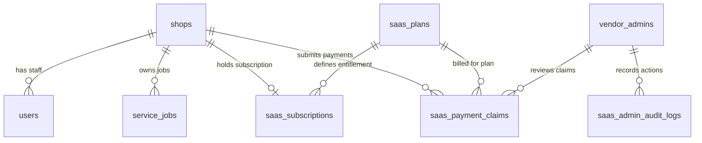

# K-Connect Cloud SaaS — Production Architecture & Operations Handbook

## 1. Executive Product Vision

**K-Connect** is a commercial, multi-tenant Cloud SaaS platform engineered specifically for computer repair centers, laptop chip-level labs, and consumer electronics service shops.

The platform unifies three distinct areas:
1. **Public Marketing Website** (`/`, `/features`, `/pricing`, `/how-it-works`, `/about`, `/demo`, `/faq`, `/contact`, `/privacy`, `/terms`, `/refund-policy`): Modern, high-conversion SaaS presence with clear product tours, transparent annual pricing, and public customer repair status tracking.
2. **Super Admin Control Center** (`/admin`): Founder-controlled management center providing real-time platform metrics, tenant shop provisioning, a 1-click GPay payment verification queue, live UPI and pricing settings, and an immutable administrative audit log.
3. **Authenticated Repair Shop Workspace** (`/app/*`): Multi-tenant workspace for shop owners and technicians featuring intake wizards, diagnostics, chip-level tracking, GST billing, inventory salvage, WhatsApp notifications, and executive BI dashboards.

---

## 2. Business Rules & Commercial Model

- **Free Trial**: Exactly 14 days, provisioned automatically upon self-service registration (`/signup`). Server-controlled and enforced on the backend.
- **Paid Subscription**: Annual billing model (₹14,999/yr standard, dynamically editable from the Super Admin panel).
- **Payment Gateway**: No third-party gateway (Razorpay/Stripe) dependencies in this initial release. Payments are collected via GPay QR Code and UPI ID.
- **Payment Verification**: Platform founder manually verifies receipt in GPay / Bank statement and executes 1-click approval in the Super Admin verification queue.
- **Licence Activation**: Approving a claim instantly provisions 365 days of annual licence in an atomic database transaction, restores active status, logs an audit event, and notifies the shop owner.
- **Graceful Expiration**: When a trial or subscription expires, customer business data (jobs, customers, inventory, invoices) is **strictly preserved**. Shop owners can log in at any time to access their data and renew via the `/checkout/annual` page without administrative lockouts.

---

## 3. Complete URL & Routing Sitemap

### Public Marketing & Visitor Routes
- `/` — Homepage (Hero, interactive workflow, 6 core subsystems, pricing preview, CTA banner).
- `/features` — Detailed walkthrough of Intake, Diagnostic Lab, Chip-Level Tracker, GST Invoicing, Salvage Inventory, and WhatsApp integration.
- `/pricing` — Transparent ₹14,999/yr annual plan comparison, 14-day trial details, and GPay QR workflow FAQ.
- `/how-it-works` — 5-step operational tour from intake to pickup.
- `/about` — Mission and design philosophy tailored to Indian electronics repair businesses.
- `/demo` — Interactive tabbed workbench tour showcasing real application workflows.
- `/faq` — Searchable accordion answering common operational, data security, and hardware questions.
- `/contact` — Sales and enterprise support inquiry form persisted directly to the platform database.
- `/privacy` — Comprehensive privacy policy covering zero cross-tenant access and AES-256 passcode encryption.
- `/terms` — Terms of service defining licensing, acceptable use, and annual subscriptions.
- `/refund-policy` — Clear policy on trial usage, payment review, and manual dispute resolution.
- `/track/:jobNumber` — Public customer repair status tracking with live stages, diagnostic summary, and shop contact details.

### Identity & Onboarding Routes
- `/login` — Multi-mode authentication supporting Shop Slug + Username/Password or quick Technician 4-digit PIN.
- `/signup` — Self-service shop registration instantly provisioning an isolated tenant workspace and 14-day trial.
- `/onboarding` — 3-step setup guiding new owners through Business Profile, Technician PIN, and first job creation.

### Commercial & Subscription Routes
- `/checkout/annual` — Dynamic GPay QR Code display, UPI ID copy action, UTR reference submission, and live review status.
- `/app/subscription` — In-workspace subscription details, trial countdown, payment claim history, and renewal options.

### Platform Super Admin Control Center (`/admin`)
- **Tenant Shops Tab**: Filter by All, Active, Frozen, Expired. Search by name, owner, or phone. Actions: Freeze/Unfreeze, +14d extension, Provision Shop.
- **GPay Verification Queue Tab**: Filter by Pending, Approved, Rejected. Inspect shop name, owner phone, UTR reference, amount (₹14,999), and customer notes. Actions: **Approve (1-Click 365-Day Activation)** or **Reject (Mandatory Reason)**.
- **Platform & UPI Settings Tab**: Real-time configuration of Merchant UPI ID (`ktech@upi`), Payee Display Name, Annual Fee in ₹ INR, Trial Duration in Days, Support Phone, and Support Email.
- **Plans & Licences Tab**: Overview of SaaS plan tiers, seat allocations, and feature flags.
- **Audit Logs Tab**: Immutable chronological log recording administrator, action, target entity, timestamp, details, and IP address.

### Repair Shop Workspace (`/app/*`)
- `/app/dashboard` — Executive KPI cards, urgent repair queues, technician leaderboard, and revenue analytics.
- `/app/jobs` & `/app/jobs/:id` — Service job management, status lifecycle, hardware passcodes, checklists, and notes.
- `/app/customers` & `/app/customers/:id` — Customer CRM, device history, and repeat visit metrics.
- `/app/technician` — Simplified workbench for bench technicians.
- `/app/inventory` & `/app/salvage` — Spare parts inventory, salvage harvesting, and low-stock alerts.
- `/app/billing` — GST tax invoices, thermal receipts, and quotation generation.
- `/app/whatsapp` — WhatsApp template communication for customer updates.
- `/app/reports` — Exportable financial, tax, and technician performance reports.

---

## 4. Multi-Tenant Database Architecture

The platform uses LibSQL / SQLite with 6 dedicated SaaS commercial tables in addition to the 40 core repair management tables:



### SaaS Commercial Tables
1. `saas_plans`: Plan code, name, annual price (₹), billing interval, trial duration, seat limit, features JSON.
2. `saas_subscriptions`: Tenant subscription state (`TRIALING`, `ACTIVE`, `EXPIRED`, `SUSPENDED`), trial start/end, period start/end, complimentary flags.
3. `saas_payment_claims`: Customer payment claims with unique UPI UTR, amount, status (`PENDING`, `APPROVED`, `REJECTED`), reviewer admin ID, and rejection reason.
4. `saas_platform_settings`: Key-value storage for merchant UPI ID, payee name, annual price, and support contact details.
5. `saas_admin_audit_logs`: Immutable security log of Super Admin approvals, rejections, freezes, and settings changes.
6. `saas_notifications`: System notifications delivered to tenant shop owners upon approval or rejection.

---

## 5. Security & Production Hardening

- **Tenant Isolation**: Every database write and read is strictly scoped to the authenticated user's `shop_id`. Cross-tenant data leakage is prevented at the SQL layer.
- **Hardware Passcode Encryption**: Customer device PINs, patterns, and Windows passwords are encrypted using **AES-256-GCM** with a distinct initialization vector per record.
- **Authentication & Rate Limiting**:
  - Global API rate limiter: 300 requests per 15 minutes.
  - Strict authentication limiter: 10 failed login attempts per 15 minutes.
  - Public registration limiter: 5 registrations per hour per IP.
- **HTTP Security Headers**: Powered by Helmet with strict Content-Security-Policy, HSTS, X-Content-Type-Options, and Frameguard.
- **Input Validation**: All incoming request payloads are strictly validated using Zod schemas (`provisionShopSchema`, `paymentClaimSchema`, etc.).
- **Graceful Renewal Middleware**: Shops with `EXPIRED` or `FROZEN` status are permitted to access `/api/subscription/*`, `/api/auth/me`, and `/api/auth/logout` so they can submit renewal payments without being blocked by authorization middleware.

---

## 6. Production Deployment Commands

### Prerequisites
- Node.js v20+ LTS
- LibSQL / SQLite or cloud Turso database

### 1. Installation
```bash
npm install
```

### 2. Environment Configuration
Copy the production environment template and configure your secrets:
```bash
cp .env.example .env
```
Ensure `JWT_SECRET` is set to a secure 32+ character random string:
```bash
openssl rand -base64 32
```

### 3. Database Migration & Seeding
```bash
npm run server
```
On startup, the backend automatically creates all 46 relational tables and seeds the default Super Admin, default Pro Annual plan (₹14,999/yr), and platform UPI settings.

### 4. Running the Verification Test Suite
```bash
npm run test
```
*Expected: 15 test files passed, 98 tests passed.*

### 5. Compiling the Production Bundle
```bash
npm run build:web
```
*Outputs minified, production-ready static assets to the `dist/` directory.*

### 6. Starting the Production Server (PM2 Example)
```bash
npm install -g pm2
pm2 start server/index.ts --name "kconnect-api" --interpreter ./node_modules/.bin/tsx
```

### 7. Nginx Reverse Proxy Configuration (Sample)
```nginx
server {
    listen 80;
    server_name kconnect.in www.kconnect.in;

    # Static Vite Frontend
    location / {
        root /var/www/kconnect/dist;
        try_files $uri $uri/ /index.html;
    }

    # Express Backend API
    location /api/ {
        proxy_pass http://127.0.0.1:5000;
        proxy_http_version 1.1;
        proxy_set_header Upgrade $http_upgrade;
        proxy_set_header Connection 'upgrade';
        proxy_set_header Host $host;
        proxy_set_header X-Real-IP $remote_addr;
        proxy_set_header X-Forwarded-For $proxy_add_x_forwarded_for;
        proxy_set_header X-Forwarded-Proto $scheme;
    }
}
```

---

## 7. Platform Verification Checklist

| Requirement | Implementation | Status |
| :--- | :--- | :--- |
| **Public SaaS Website** | 12 responsive pages inspired by modern SaaS aesthetic | ✅ Verified |
| **14-Day Free Trial** | Server-calculated and enforced on registration (`/signup`) | ✅ Verified |
| **Annual GPay QR Workflow** | Dynamic UPI QR display, UTR submission, review notices | ✅ Verified |
| **Super Admin Control Center** | 5 functional tabs: Shops, Verification Queue, Settings, Plans, Audits | ✅ Verified |
| **1-Click Payment Approval** | 365-day atomic activation transaction + audit log | ✅ Verified |
| **Shop Isolation** | Scoped SQL queries with JWT shop context | ✅ Verified |
| **Data Preservation** | Expired shops keep all data intact and can access renewal | ✅ Verified |
| **Automated Test Baseline** | 98 passing tests across 15 test files | ✅ 100% Passed |
| **TypeScript Diagnostics** | `tsc --noEmit` exits with 0 errors | ✅ 100% Clean |
| **Production Web Build** | `vite build` completed successfully | ✅ 100% Clean |
